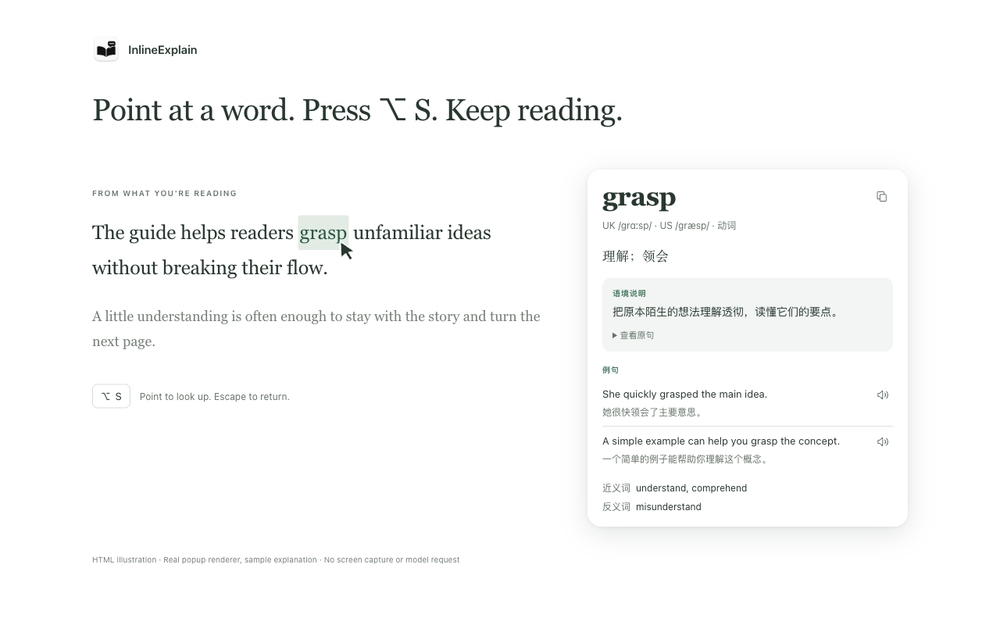

# InlineExplain

Understand an English word in its sentence, without leaving your current app.

**Point at a word → press Option+S → read its meaning in context.**

**[Download for macOS](https://github.com/Wake-C/inlineExplain/releases/latest)** · [简体中文](README.md) · macOS 15+ · Apple Silicon

Illustrative HTML preview, using the app's popup renderer. [Prototype source](docs/popup-preview.html).

## A little help, then keep reading

InlineExplain reads the word under your pointer and the nearby sentence. A small white popup gives you its meaning in that context, pronunciation, examples and useful related words. You can check the original sentence, hear an example or copy the explanation.

The popup is designed to keep the source app active, including in full screen. Press **Escape** or click outside to dismiss it. Chinese is the default; switch to English in Settings. Each language has its own editable prompt.

## Get started

1. Download the DMG, open it and drag **InlineExplain** to **Applications**. Open the app from there.
2. Click the InlineExplain book icon in the menu bar and open **Settings**. Add your provider URL, model and API key. The defaults are `https://api.deepseek.com` and `deepseek-chat`; other Chat Completions-compatible services can also be used. Your provider may charge for requests.
3. Allow **Screen Recording** when prompted. Quit and reopen InlineExplain if macOS asks.
4. Point directly at a visible English word and press **Option+S**. You do not need to select or copy it first.

Updates keep your saved provider settings; the DeepSeek default applies on first launch.

The release is ad-hoc signed and is not notarized by Apple. If macOS blocks it, open **System Settings → Privacy & Security → Open Anyway** only if you trust this project and its download.

If another app uses Option+S, pause that shortcut or choose **Option+Shift+S** in InlineExplain Settings.

## Privacy and limits

Capture and Apple Vision OCR run on your Mac, only when you use the shortcut. Screenshots stay in memory. The word and a short surrounding context go to your chosen model service. API keys stay in macOS Keychain; reading text, screenshots and answers are not saved or logged by the app.

OCR can read only visible text. Off-screen sentences, protected video, tiny text and complex layouts can leave it with too little context. Model explanations can be wrong. This version looks up individual words; it has no phrase selection, reading history, flashcards or auto-update.

## Development

Build and verification commands are in [Development](docs/development.md). To make a release DMG locally, run `./scripts/package.sh`. The [release guide](docs/releasing.md) covers the same command in the manual GitHub Actions workflow. Pushes do not start packaging or test jobs.

InlineExplain is a separate macOS companion to [Peekturn](https://github.com/Wake-C/peekturn), an English reading app for Android. Prompt and code provenance are listed in [Third-party notices](NOTICE).
