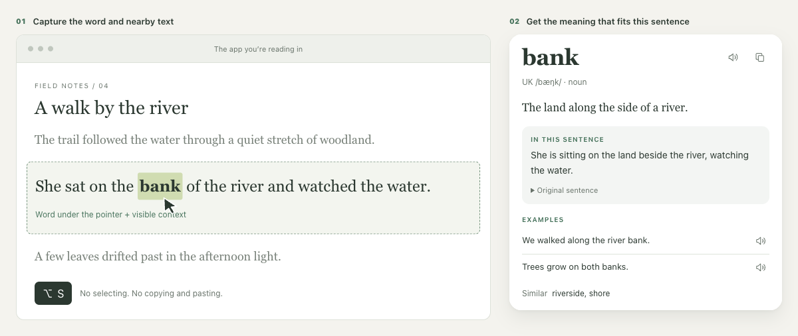

# InlineExplain

### Understand an English word in context, in any app.

Point at a word and press <kbd>⌥</kbd> <kbd>S</kbd>. InlineExplain reads **the word and nearby sentences from your screen**, then explains what it means in that context, beside the original text.

**[Download for macOS ↗](https://github.com/Wake-C/inlineExplain/releases/latest)** · [简体中文](README.md) · [Get started](#get-started) · [Privacy](#what-leaves-your-mac)

macOS 15+ · Apple Silicon · Bring your own model API key

Illustrative scene with the real card renderer and a sample explanation. Green marks explain capture scope; they are not app overlays. [Interactive preview source](docs/popup-preview.html)

## Stay where you are reading

Look up words in web pages, PDFs, documents, or visible video subtitles. InlineExplain uses screen capture and local OCR, so it needs no browser extension, text selection, or copy and paste. Recognition depends on the text being visible, clear, and available for capture.

| Your action | What InlineExplain does |
| --- | --- |
| Point at an English word and press **Option+S** | Recognizes the word under your pointer and the visible text around it |
| Read the explanation beside the source | Uses the nearby sentence to explain the meaning, with IPA, examples, and related words |
| Press **Escape** or click outside | Dismisses the card so you can keep reading |

The floating card is designed to preserve the source app's focus and full-screen Space. It reads visible context, not the whole document or sentences off screen.

## Hear the word, too

- The speaker beside the word plays Youdao's US pronunciation, with macOS speech as a fallback when the service is unavailable.
- Enable **Speak the word automatically** in Settings to hear each lookup. It is off by default.
- Example sentences use macOS speech.
- Explanations default to Chinese. Switch to English in Settings; each language keeps its own custom prompt.

## Get started

1. **Install.** [Download the DMG](https://github.com/Wake-C/inlineExplain/releases/latest), drag InlineExplain to **Applications**, and open it from there.
2. **Connect a model.** Open **Settings** from the menu-bar book icon. Add your provider URL, model, and API key. The defaults are `https://api.deepseek.com` and `deepseek-chat`; other Chat Completions-compatible services also work. Your model provider may charge for requests.
3. **Allow capture.** Grant **Screen Recording** access. Quit and reopen the app if macOS asks.
4. **Read.** Point at an English word and press **Option+S**. If that shortcut conflicts with another app, choose **Option+Shift+S** in Settings.

> **Opening the app for the first time**
>
> Releases use a self-signed certificate and are not notarized by Apple. If macOS blocks the app, use **System Settings → Privacy & Security → Open Anyway** only if you trust the project and download.
>
> Updating from an ad-hoc build, version 0.1.6 or earlier, may require granting Screen Recording again. New releases use a fixed signing identity, but permission retention across updates still needs installed-app verification. Updates keep your saved model-provider settings.

## What leaves your Mac?

| Content | Where it goes |
| --- | --- |
| Screenshots | Captured only on the shortcut, processed by local OCR, and kept in memory |
| The word and a short surrounding context | Sent to your configured model provider for the explanation |
| Word pronunciation | Manual playback or automatic pronunciation sends the word to Youdao's unofficial, key-free endpoint |
| API keys | Stored only in macOS Keychain, not in the settings file |

The app does not save or log screenshots, reading text, or explanations. This project does not control the availability of Youdao's endpoint.

**Limits:** protected video, tiny text, and complex layouts may prevent recognition. Model explanations can be wrong. This version looks up individual words; it has no phrase selection, reading history, flashcards, or auto-update.

## Development and origins

[Development](docs/development.md) · [Architecture](docs/architecture.md) · [Packaging and releases](docs/releasing.md) · [Third-party notices](NOTICE)

InlineExplain is a separate macOS reading companion. [Peekturn](https://github.com/Wake-C/peekturn) is an English reading app for Android; some prompts and code follow its design, as listed in the third-party notices.
