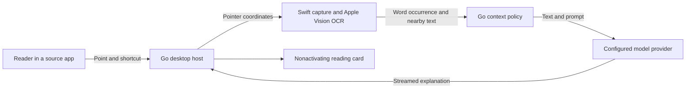

# Architecture

InlineExplain is a menu-bar companion for readers using other macOS apps.
The reader points at a visible word and presses the global shortcut. A local
capture helper finds that exact word occurrence and its surrounding text;
the reader's chosen model explains it in a small floating card. The source
application remains the reading surface.

## Integration owners

- **Desktop host:** [`main.go`](../main.go) and [`locale.go`](../locale.go) own
  lookup orchestration, cancellation, native windows, shortcuts and menus.
  MyGo supplies the menu bar, WKWebView bridge and nonactivating NSPanel.
  A panel must not activate the app or switch the user's full-screen Space.
- **Capture boundary:** [`capture.go`](../capture.go) invokes the bundled
  `InlineExplainOCR` helper and consumes its JSON result.
  [`native/Capture.swift`](../native/Capture.swift) uses ScreenCaptureKit and
  Apple Vision; [`native/ContextWindow.swift`](../native/ContextWindow.swift)
  groups nearby lines while avoiding unrelated columns. Geometry identifies
  the pointed occurrence, including repeated words; text search must not
  replace that occurrence with another match.
- **Context policy:** [`internal/explain/context.go`](../internal/explain/context.go)
  owns sentence boundaries and context limits. The provider receives
  `selection`, `before`, `after`, `sourceTitle` and `sectionTitle` as data.
  The desktop source title currently identifies the frontmost application;
  it is not a document title or a persistent reading locator.
- **Provider boundary:** [`internal/explain/client.go`](../internal/explain/client.go)
  owns compatible Chat Completions requests and streaming validation.
  [`internal/explain/explanation.go`](../internal/explain/explanation.go) owns
  the answer schema. The service receives text, not a screenshot. Custom
  prompts must preserve that answer schema. DeepSeek thinking is disabled;
  unrelated model families do not receive its provider-specific parameter.
- **Settings and credentials:** [`settings.go`](../settings.go) owns saved
  preferences and Keychain identity. Keys are scoped to the canonical origin
  (scheme, IDNA-normalized host and port) and local login account. Host
  normalization must agree with the HTTP client's IDNA behavior. Plain saved
  settings do not contain a key. Partial Settings writes and revisioned
  replies preserve edits when windows reopen or responses arrive late.
- **Presentation:** [`frontend/`](../frontend/) renders lookup and Settings
  state through the MyGo bridge. [Design](../DESIGN.md) owns presentation taste;
  the frontend has no OCR, credential or provider policy.

## Runtime and verification boundaries

Screen Recording permission is required. Test permission identity from a
complete `.app` bundle in its installed location; a raw executable does not
prove the installed app has access. Keep the app and helper identifiers stable
when updating packaging. Capture excludes the app's own windows.

OCR sees only visible pixels. Off-screen sentences, protected content, tiny
text and complex layouts can leave insufficient context. The context is a
bounded view of the screen, not an EPUB or video locator. There is no
phrase-selection or source-document integration.

[`scripts/test.sh`](../scripts/test.sh) owns the automated test entry point.
The Swift OCR fixture exercises Apple Vision on synthetic text. A live-provider
test requires an explicitly authorized external Keychain profile; it is not a
default CI credential. Keep profiles and provider details outside the repo.

Builds, browser previews and controller tests do not establish native
acceptance. Verify the installed app with real visible text, physical pointing
and the shortcut, full-screen focus, dismissal, Settings reopen and relevant
background/offline behavior. Check audible example playback when changing
speech. Report unavailable checks separately from passes.

Code and prompt provenance belong in [Third-party notices](../NOTICE).
